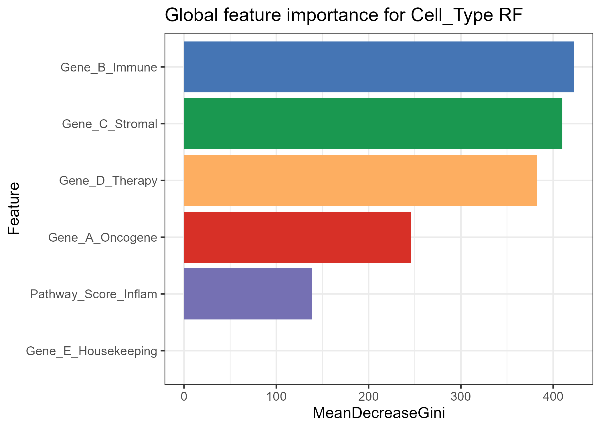
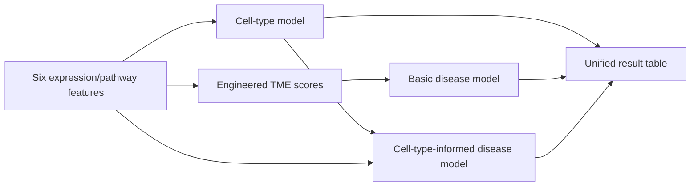
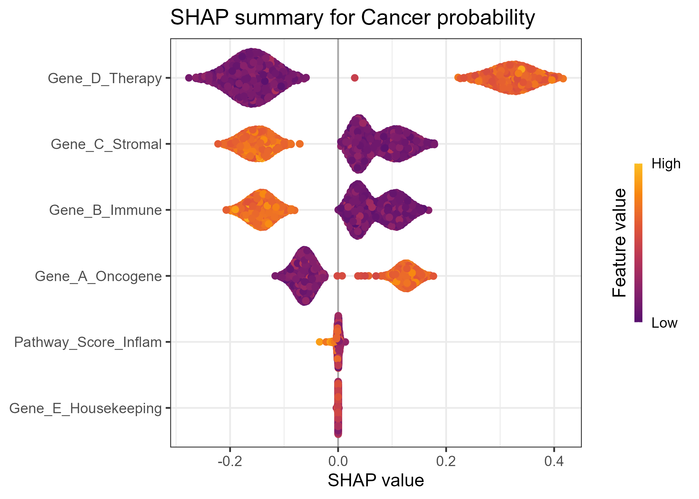
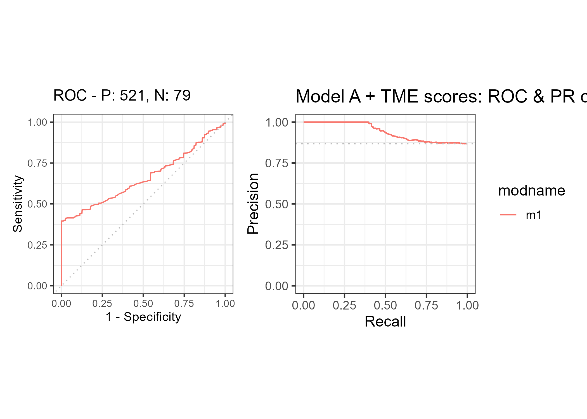

<div align="center">

# geneTMEpredict

**A reusable R model engine for synthetic tumour-microenvironment classification**

[](https://github.com/Ci-yo/BIO215_Capstone_geneTMEpredict/actions/workflows/repository-check.yml)




<sub>The model layer behind TME Explorer: cell type, disease state and a context-aware combined prediction.</sub>

</div>

## Step-by-step guide

### 1. Install and load the package

Install [R](https://cran.r-project.org/) (R 4.4+ recommended). In the
**R console**:

```r
install.packages(c("randomForest", "remotes"),
                 repos = "https://cloud.r-project.org")
remotes::install_github("Ci-yo/BIO215_Capstone_geneTMEpredict", upgrade = "never")
library(geneTMEpredict)
```

Use `geneTMEpredict` in `library()`, not the longer repository name.
The installed package includes all three model objects.

### 2. Load the example input

```r
example_path <- system.file("extdata", "gene_input_example.csv",
                            package = "geneTMEpredict", mustWork = TRUE)
cells <- read.csv(example_path)
head(cells)
```

Each row is one synthetic cell. No external data download or training is needed.

### 3. Run all three predictions

```r
result <- predict_tme_all(cells)
prediction_columns <- c("pred_Cell_Type", "pred_Disease_basic",
                        "pred_Disease_with_CT")
head(result[prediction_columns])
stopifnot(nrow(result) == nrow(cells),
          !anyNA(result[prediction_columns]))
```

| Column | Meaning |
|---|---|
| `pred_Cell_Type` | `Cancer`, `T_Cell` or `Fibroblast`. |
| `pred_Disease_basic` | `Tumor` or `Healthy_Control`, using features plus engineered scores. |
| `pred_Disease_with_CT` | The disease model with predicted cell type added. |

The package returns class labels, not confidence intervals or calibrated
clinical probabilities. Individual functions are also available:

```r
predict_celltype_rf(cells)
predict_disease_basic_rf(cells)
```

### 4. Save the result and reuse the schema

```r
write.csv(result, "tme_predictions.csv", row.names = FALSE)
getwd()
```

The file is saved in the directory printed by `getwd()`. To use another
prepared table, replace `cells` with `read.csv("your_cells.csv")`.
The six required numeric columns are:

```text
Gene_E_Housekeeping,Gene_A_Oncogene,Gene_B_Immune,Gene_C_Stromal,Gene_D_Therapy,Pathway_Score_Inflam
```

Before predicting, verify the input:

```r
features <- names(read.csv(example_path))
stopifnot(all(features %in% names(cells)))
stopifnot(all(vapply(cells[features], function(x) {
  is.numeric(x) && all(is.finite(x))
}, logical(1))))
```

The basic model constructs `Tumor_score = Gene_A_Oncogene + Gene_D_Therapy`,
`Immune_score = Gene_B_Immune + Pathway_Score_Inflam`, and
`Stromal_score = Gene_C_Stromal` internally. These synthetic feature names
do not map directly to an arbitrary real gene-count matrix.

### 5. Troubleshooting and source checks

| Symptom | Action |
|---|---|
| Package or `.rds` file not found | Reinstall the complete package and load `geneTMEpredict`. |
| `newdata is missing required columns` | Preserve the exact six headers from the example. |
| Missing values appear after numeric conversion | Remove units/text in numeric columns and validate values before predicting. |
| You want a dashboard | Use the companion [TME Explorer](https://github.com/Ci-yo/BIO215_Capstone_TME-Shiny). |

To inspect source, clone
`https://github.com/Ci-yo/BIO215_Capstone_geneTMEpredict.git`, enter that
directory, and run `python scripts/validate_repository.py` with Python 3.10+.
That structural check does not replace running the example predictions.

## Package at a glance

`geneTMEpredict` turns three trained Random Forest models into a small, documented prediction API. It accepts synthetic scRNA-seq-style gene and pathway features and returns cell-type and tumour-state classifications in analysis-ready tables.

| Function | Model task | Output |
|---|---|---|
| `predict_celltype_rf()` | `Cancer` / `T_Cell` / `Fibroblast` | cell-type factor |
| `predict_disease_basic_rf()` | `Tumor` / `Healthy_Control` | disease-state factor |
| `predict_tme_all()` | run all three bundled models | input + three prediction columns |

The interactive companion is [`TME Explorer`](https://github.com/Ci-yo/BIO215_Capstone_TME-Shiny), a separate Shiny repository for exploration, upload workflows and gene-level “what-if” experiments.

## Model architecture



The basic disease model adds three deterministic features: `Tumor_score`, `Immune_score` and `Stromal_score`. The third model tests whether predicted cellular identity adds context to disease-state classification.

## Evidence, not just endpoints

<table>
  <tr>
    <td width="50%" align="center"><br><strong>Local and global signal</strong><br>SHAP distribution for the cancer class.</td>
    <td width="50%" align="center"><br><strong>Disease-model performance</strong><br>ROC and precision–recall views after score engineering.</td>
  </tr>
</table>

## Repository guide

```text
BIO215_Capstone_geneTMEpredict/
├── R/                 exported prediction API
├── man/               generated function documentation
├── inst/extdata/      three models and example input
├── figs/              model interpretation and evaluation
├── scripts/           dependency-free package archive check
└── DESCRIPTION        package metadata and dependencies
```

Run the same repository-level check used by GitHub Actions:

```bash
python scripts/validate_repository.py
```

## Scope and responsible use

The training data are fully synthetic. This makes the project useful for teaching model packaging, interpretation and deployment, but it does **not** establish clinical validity. Outputs are demonstrations, not patient-level predictions.

The package is licensed under MIT.

> **Academic-use note**  
> This is a completed coursework portfolio project. Follow your institution's academic-integrity rules when reusing it.
