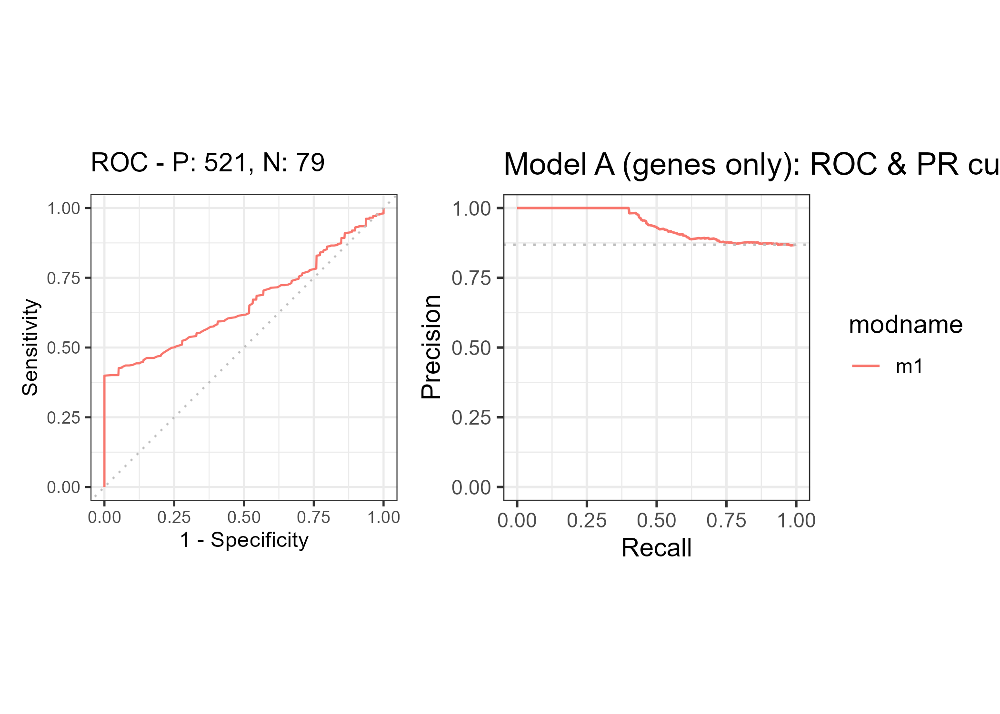
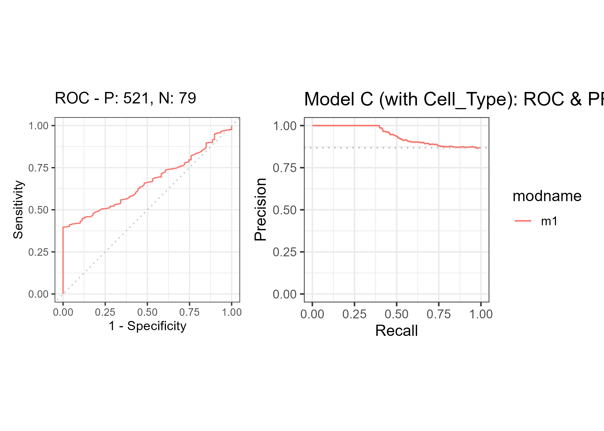

# geneTMEpredict

`geneTMEpredict` is an R package that provides pre-trained random forest
models to predict **cell types** and **disease status** in a synthetic
tumor microenvironment (TME) single-cell RNA-seq dataset.

The package is designed to demonstrate a complete workflow that
combines:

- data preprocessing and feature engineering;
- machine learning model training and evaluation;
- deployment of the final models as a reusable R package (and as a
  backend for a Shiny web application).

------------------------------------------------------------------------

## Dataset overview

The models in `geneTMEpredict` are trained on the Kaggle dataset  
**“Gene Expression Analysis and Disease Relationship (Synthetic)”**,  
which simulates single-cell RNA-seq (scRNA-seq) data from a solid tumor
microenvironment.

### Context and inspiration

This is a synthetic single-cell RNA sequencing (scRNA-seq) dataset
designed to simulate the complex biological environment of a solid
tumor. The primary motivation is the difficulty of obtaining clean,
annotated, and privacy-compliant single-cell data for educational and
benchmark purposes.

The dataset models the tumor microenvironment (TME), which is critical
in cancer progression and immunotherapy response. It allows users to
practice core scRNA-seq analysis tasks, including:

- cell type identification,
- differential gene expression analysis,
- discovering potential therapeutic targets.

### Core analytical challenges

Using this dataset, one can:

- **Cell type classification**  
  Build machine learning models to classify single cells into one of
  three cell types based on their gene expression profiles: `Cancer`,
  `T_Cell`, `Fibroblast`.

- **Biomarker discovery**  
  Identify which genes or pathway scores (e.g. `Gene_A_Oncogene`,
  `Gene_B_Immune`, `Pathway_Score_Inflam`) are the most powerful
  predictors of cell type or disease state.

- **Visualization and dimensionality reduction**  
  Apply techniques such as PCA or UMAP to confirm the biological
  separation of the defined cell types and TME states.

### Source information

The data is entirely synthetic and was generated using a log-normal
distribution model to mimic the sparsity and variability inherent in
real scRNA-seq count data. This ensures that:

- the dataset is clean;
- it lacks real-world privacy concerns;
- it is suitable for benchmarking machine learning algorithms in a
  teaching context.

Because the dataset is clean and fully synthetic, it is especially
suited for teaching machine learning, model evaluation, and deployment.

------------------------------------------------------------------------

## Package functionality

`geneTMEpredict` currently ships three pre-trained random forest models:

1.  **Cell type model**

    - Outcome: `Cell_Type` (`Cancer`, `T_Cell`, `Fibroblast`)
    - Predictors:
      - `Gene_E_Housekeeping`
      - `Gene_A_Oncogene`
      - `Gene_B_Immune`
      - `Gene_C_Stromal`
      - `Gene_D_Therapy`
      - `Pathway_Score_Inflam`

2.  **Disease model (basic)**

    - Outcome: `Disease_Status` (`Healthy_Control`, `Tumor`)
    - Predictors: the six features above plus three derived scores:
      - `Tumor_score   = Gene_A_Oncogene + Gene_D_Therapy`
      - `Immune_score  = Gene_B_Immune + Pathway_Score_Inflam`
      - `Stromal_score = Gene_C_Stromal`

3.  **Disease model (with cell type)**

    - Outcome: `Disease_Status` (`Healthy_Control`, `Tumor`)
    - Predictors: the six gene/pathway features + predicted `Cell_Type`.

Model training is handled by a separate script (`01_train_models.R`),
which:

- reads the original CSV dataset;
- performs preprocessing and feature engineering;
- splits the data into 80% training and 20% test sets;
- fits three `randomForest` models (`ntree = 500`, `importance = TRUE`);
- saves them as `.rds` files under `inst/extdata`;
- creates an example file `gene_input_example.csv`.

------------------------------------------------------------------------

## Quick start

The package provides three main user-facing prediction functions:

- `predict_celltype_rf()` – cell type classification  
- `predict_disease_basic_rf()` – disease status using gene + score
  features  
- `predict_tme_all()` – convenience wrapper returning all predictions

A small example input table `gene_input_example.csv` is bundled to
illustrate usage.

``` r
library(geneTMEpredict)
path <- system.file("extdata", "gene_input_example.csv",
                    package = "geneTMEpredict")
ex_df <- read.csv(path)

head(ex_df)
```

### Cell type prediction

``` r
ct_pred <- predict_celltype_rf(ex_df)
head(ct_pred)
table(ct_pred)
```

### Disease status prediction (basic model)

``` r
ds_basic <- predict_disease_basic_rf(ex_df)
head(ds_basic)
table(ds_basic)
```

### Joint prediction of TME state

``` r
tme_res <- predict_tme_all(ex_df)
head(tme_res)
```

The resulting `tme_res` contains the original feature columns plus:

- `pred_Cell_Type`
- `pred_Disease_basic`
- `pred_Disease_with_CT`

This output can be directly consumed by a Shiny dashboard or used for
downstream visualisation and interpretation.

------------------------------------------------------------------------

## Suggested figures

### Global feature importance (Cell_Type model)

<figure>

<figcaption aria-hidden="true">Feature importance for Cell_Type
RF</figcaption>
</figure>

### SHAP summary for Cancer probability

<figure>

<figcaption aria-hidden="true">SHAP summary for Cancer
probability</figcaption>
</figure>

### ROC & PR curves for disease models

**Model A (genes only)**  


**Model A + scores**  


**Model C (with Cell_Type)**  


------------------------------------------------------------------------

## How the models were trained (summary)

For reproducibility, the training script follows this pipeline:

1.  **Data loading and factor setup**

    - Reads
      `Gene_Expression_Analysis_and_Disease_Relationship_Synthetic.csv`.  
    - Sets factor levels for `Cell_Type` and `Disease_Status` with
      explicit ordering.

2.  **Feature engineering**

    Computes TME-related scores:

    - `Tumor_score   = Gene_A_Oncogene + Gene_D_Therapy`  
    - `Immune_score  = Gene_B_Immune + Pathway_Score_Inflam`  
    - `Stromal_score = Gene_C_Stromal`

3.  **Train/test split**

    - 80% training / 20% test (`set.seed(123)` for reproducibility).

4.  **Random forest models**

    - Uses `randomForest::randomForest()` with `importance = TRUE` and
      `ntree = 500` for each of the three tasks.

5.  **Model export**

    - Saves trained models as:
      - `rf_celltype.rds`
      - `rf_disease_basic.rds`
      - `rf_disease_ct.rds`
    - Generates `gene_input_example.csv` containing only predictor
      columns for easy demonstration and Shiny input templates.

End users of this package do **not** need to rerun the training code
unless they want to retrain or extend the models.

------------------------------------------------------------------------

## Using `geneTMEpredict` in a Shiny app

A typical Shiny application can use `geneTMEpredict` as its backend.

### Front-end

- Upload or edit a table of gene-level features  
  (same columns as `gene_input_example.csv`).  
- Display summary statistics and basic QC plots.

### Back-end

- Call `predict_tme_all()` on the uploaded data.  
- Show predicted cell types and disease status in tables and plots  
  (e.g. bar charts, stacked proportions, TME score scatter plots).

This makes the overall project workflow:

> Kaggle synthetic scRNA-seq dataset → ML training script →  
> R package (`geneTMEpredict`) → Shiny web interface

which is exactly the combination of machine learning + Shiny + R package
development required for the BIO215 capstone.

------------------------------------------------------------------------

## License

This package is released under the MIT License.  
See the `LICENSE` file for details.
